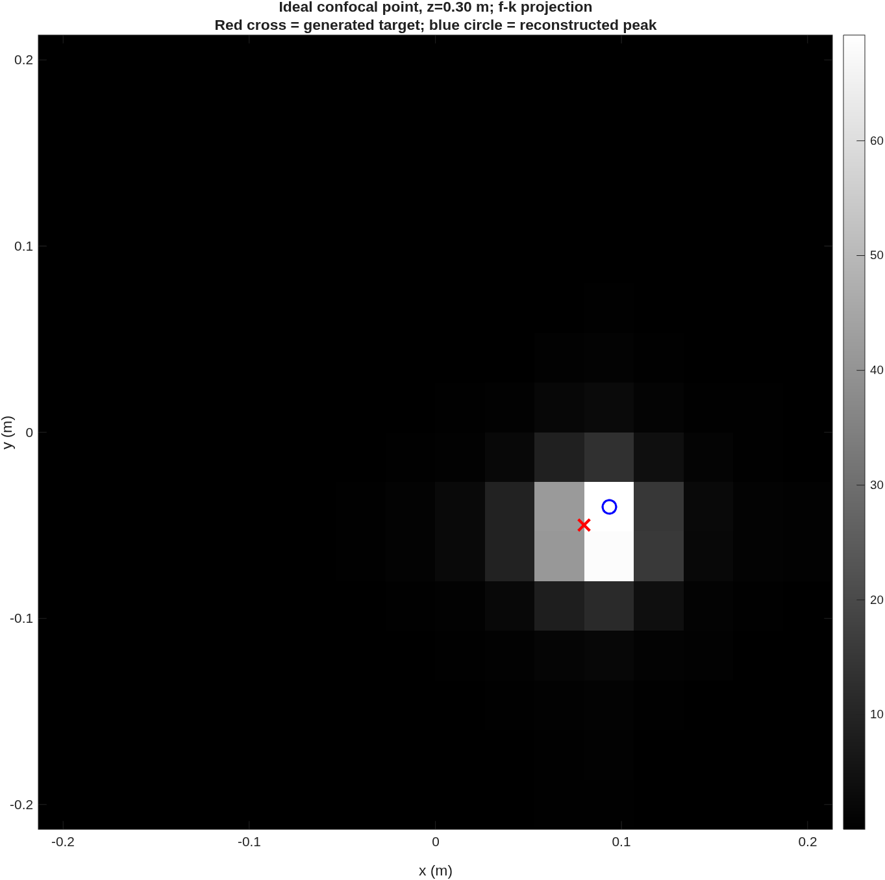

# HiddenWave

**Hidden-scene volumes from time-resolved light measurements.**

A scanned wall acts as an indirect view of a scene outside the camera's line of sight. HiddenWave reconstructs the hidden volume in MATLAB using backprojection, light-cone inversion or f-k migration.


*Retained research illustration under its [source terms](LICENSE), separate from the synthetic check below.*

[Try the offline check](#start-without-capture-data) · [Use calibrated measurements](#reconstruct-your-measurements) · [Inspect the methods](cnlos_reconstruction.m)

<a id="quick-start"></a>
<a id="verification"></a>

## Start without capture data

For an independently predicted numerical scene, run this bounded example first:

```matlab
addpath('examples');
confocal_point('point-a', [.08, -.05, .30]);
confocal_point('point-b', [-.08, .05, .40]);
```

It generates original confocal point returns from the roundtrip light path
`2*sqrt((wall_x-x)^2+(wall_y-y)^2+z^2)`, then runs the actual f-k reconstruction.
Each new directory contains the measurement/volume MAT file, maximum-projection
CSV, coordinate/error JSON and a labeled PNG. Existing directories are refused.
The two signed targets test lateral orientation and changed depth. Acceptance
bounds are fixed from the 16×16 scan grid and 128-bin, 32 ps sampling, not saved
expected volumes. This is ideal generated-input execution, not a captured scene
or a physical accuracy measurement. The retained research illustration above is
not the output of this example.



*Actual output of `confocal_point` at the verified reconstruction revision
`af285c8`, [MATLAB CI run40972892515](https://github.com/nazeeh111/HiddenWave/actions/runs/40972892515).
Red marks the original generated target; blue marks the actual reconstructed peak.
For target `[.08,-.05,.30]`m the peak was `[.09333,-.04,.30478]`m; the changed
`[-.08,.05,.40]`m target peaked at `[-.09333,.06667,.40154]`m. These are ideal-input
observations within the declared grid bounds, not measured-scene accuracy.*

### Original execution smoke check

Open MATLAB in the repository root and run:

```matlab
run('tests/smoke_test.m')
```

The check runs backprojection, light-cone inversion and f-k migration on a seeded random **8 × 8 × 32** array. It checks exact agreement between `hidden_wave` and the retained function, output dimensions, and finite, nonnegative, nonzero values. It prints:

```text
PASS HiddenWave: three reconstruction modes, exact facade parity, finite nonzero volumes
```

Base MATLAB is sufficient for this check. The random array tests execution; it does not represent a measured hidden scene or establish reconstruction accuracy. See the [verification record](docs/VERIFICATION.md) for the recorded environment and limits.

<a id="inputs-and-workflows"></a>

## Reconstruct your measurements

With calibrated transient measurements loaded:

```matlab
% meas: N × N × T; already aligned to the scanned wall in this example
% wall_size: scanned wall width in meters
volume = hidden_wave(meas, [], wall_size, 2, 512, 32e-12);
```

The original six arguments remain available in [`cnlos_reconstruction`](cnlos_reconstruction.m):

| Argument | Meaning |
| --- | --- |
| `meas` | Square spatial grid × time bins (`N × N × T`). |
| `tofgrid` | Per-position time-of-flight correction in **picoseconds**; use `[]` only for already corrected data. |
| `wall_size` | Width of the square scanned region, in **meters**. |
| `alg` | Method selector from the table below. |
| `crop` | Number of time bins kept **after** alignment; the example keeps 512, so `T` must be at least 512. |
| `bin_resolution` | Time per bin in **seconds**; `32e-12` means 32 ps. |

The returned volume is **y × x × depth**. Default calls still open the original
front, top and side projections. To reconstruct without creating figures and
inspect the nominal coordinate axes:

```matlab
[volume, info] = hidden_wave(meas, [], wall_size, 2, [], [], false);
% info.x_m, info.y_m, info.z_m; info.bin_resolution_s; info.crop_bins
```

`[]` selects the default crop or bin interval. The default crop is the smaller
of 512 and the available time bins. At least 12 bins are required because the
retained display-boundary suppression removes the final 11 bins. Modes 0, 1 and
3 also require a power-of-two crop; mode 2 accepts other admitted lengths.
Unsupported shapes, invalid calibration and negative f-k intensities fail before
allocation/graphics. Signed inputs remain admitted by the other retained modes.
The nominal depth axis preserves the original inclusive endpoint convention;
its last coordinate is `crop * c * bin_resolution / 2`, while acquisition samples
run from time zero through `(crop-1) * bin_resolution`. Match calibration, scan size and timing to your capture; changing these values changes the reconstructed geometry.

| `alg` | Retained method | Entry requirements |
| --- | --- | --- |
| `0` | Filtered backprojection | Base MATLAB; covered by the small offline check. |
| `1` | Light-cone transform inversion | Base MATLAB; covered by the small offline check. |
| `2` | Frequency-wavenumber (f-k) migration | Base MATLAB; covered by the small offline check. |
| `3` | Phasor fields | The facade temporarily adds `util/`; direct legacy calls need it on the path. Signal Processing Toolbox (`gausswin`) is still required and diagnosed explicitly. Outside the numerical point check. |

[`demo.m`](demo.m) maps the larger captured-data, interactive, nonplanar and phase-retrieval workflows. It expects external capture folders such as `statue/` and `interactive/`; they are not bundled. If it reports a missing `.mat` file, start with the offline check or obtain the matching research capture before running that section. Existing script and function names remain available.

<a id="license"></a>
<a id="research-citation"></a>

## License

The original scene illustrations and unamended numerical files are preserved; [NOTICE.md](NOTICE.md) records the source and the intentional admission/headless changes to `cnlos_reconstruction.m`. The reconstruction formulas are retained. The numerical source retains its institutional academic/noncommercial terms in [LICENSE](LICENSE). MIT in [LICENSE-branding](LICENSE-branding) covers the new documentation, artwork, wrapper and checks only.
