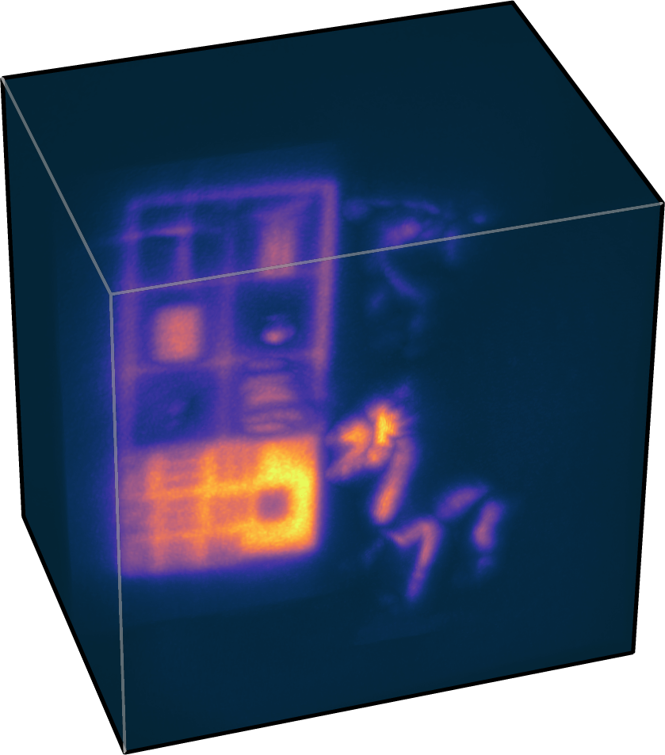

# HiddenWave

**Hidden-scene volumes from time-resolved light measurements.**

A scanned wall acts as an indirect view of a scene outside the camera's line of sight. HiddenWave retains the MATLAB reconstruction methods from [nlos-fk](https://github.com/computational-imaging/nlos-fk/tree/d34d49fed5a86f4ebddf85d461cff6923de5367d), with a forwarding entry point and small offline checks. The research methods are the original authors' work; this edition adds access and verification guidance.



*Original nlos-fk scene illustration, retained under its [source terms](LICENSE). This is upstream research imagery, not output from the synthetic check below.*

[Try the offline check](#start-without-capture-data) · [Use calibrated measurements](#reconstruct-your-measurements) · [Inspect the methods](cnlos_reconstruction.m) · [Source and additions](NOTICE.md)

<a id="quick-start"></a>
<a id="verification"></a>

## Start without capture data

Open MATLAB in the repository root and run:

```matlab
run('tests/smoke_test.m')
```

The check runs backprojection, light-cone inversion and f-k migration on a seeded random **8 × 8 × 32** array. It checks exact agreement between `hidden_wave` and the retained function, output dimensions, and finite, nonnegative, nonzero values. It prints:

```text
PASS HiddenWave: three reconstruction modes, exact facade parity, finite nonzero volumes
```

Base MATLAB is sufficient for this check. The random array tests execution; it does not represent a measured hidden scene or establish reconstruction accuracy. See the [verification record](docs/VERIFICATION.md) for the recorded environment and limits.

<a id="inputs-and-workflows"></a>

## Reconstruct your measurements

With calibrated transient measurements loaded:

```matlab
% meas: N × N × T; already aligned to the scanned wall in this example
% wall_size: scanned wall width in meters
volume = hidden_wave(meas, [], wall_size, 2, 512, 32e-12);
```

The six arguments are passed unchanged to [`cnlos_reconstruction`](cnlos_reconstruction.m):

| Argument | Meaning |
| --- | --- |
| `meas` | Square spatial grid × time bins (`N × N × T`). |
| `tofgrid` | Per-position time-of-flight correction in **picoseconds**; use `[]` only for already corrected data. |
| `wall_size` | Width of the square scanned region, in **meters**. |
| `alg` | Method selector from the table below. |
| `crop` | Number of time bins kept **after** alignment; the example keeps 512, so `T` must be at least 512. |
| `bin_resolution` | Time per bin in **seconds**; `32e-12` means 32 ps. |

The returned volume is spatial × spatial × depth. The retained function also opens front, top and side projections. Match calibration, scan size and timing to your capture; changing these values changes the reconstructed geometry.

| `alg` | Retained method | Entry requirements |
| --- | --- | --- |
| `0` | Filtered backprojection | Base MATLAB; covered by the small offline check. |
| `1` | Light-cone transform inversion | Base MATLAB; covered by the small offline check. |
| `2` | Frequency-wavenumber (f-k) migration | Base MATLAB; covered by the small offline check. |
| `3` | Phasor fields | First add `util/` to the MATLAB path (`addpath('util')`); also needs Signal Processing Toolbox (`gausswin`). Outside that check. |

[`demo.m`](demo.m) maps the larger captured-data, interactive, nonplanar and phase-retrieval workflows. It expects external capture folders such as `statue/` and `interactive/`; they are not bundled. If it reports a missing `.mat` file, start with the offline check or obtain the matching research capture before running that section. Existing script and function names remain available.

<a id="license"></a>
<a id="research-citation"></a>

## Research and license

David B. Lindell, Gordon Wetzstein and Matthew O'Toole. 2019. *Wave-based non-line-of-sight imaging using fast f-k migration*. ACM Transactions on Graphics 38(4), Article 116. [Project and citation](https://www.computationalimaging.org/publications/nlos-fk/).

The original numerical source and scene illustrations are retained byte-for-byte; [NOTICE.md](NOTICE.md) records provenance. The numerical source retains its institutional academic/noncommercial terms in [LICENSE](LICENSE). MIT in [LICENSE-branding](LICENSE-branding) covers the new documentation, artwork, wrapper and checks only.
